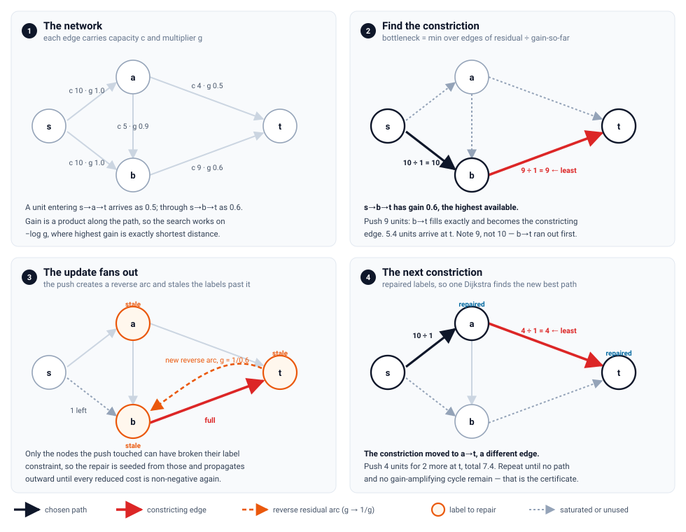

# generalized-maxflow

Maximum flow through a network whose edges **change the amount that passes
through them**.

Every edge carries a capacity and a multiplier. Pushing `x` units into an edge
consumes `x` units of its capacity and delivers `multiplier · x` units at the
far end, so flow can leak away (multiplier below 1), be conserved (exactly 1) or
be amplified (above 1). This is the *generalized maximum flow* problem, and it
is what you want for power transmission with line losses, currency conversion,
evaporation and spoilage in logistics, or any pipeline whose stages have a
yield.

The interface is a JSON adjacency list, the same for every binding:

```json
{
  "source": "s",
  "sink": "t",
  "adjacency": {
    "s": [{"to": "a", "capacity": 10, "multiplier": 1.0}],
    "a": [{"to": "t", "capacity": 5,  "multiplier": 2.0}]
  }
}
```

```json
{
  "status": "optimal",
  "max_flow": 10,
  "source_outflow": 5,
  "paths": [
    {
      "kind": "path",
      "flow_in": 5, "flow_out": 10, "gain": 2,
      "nodes": ["s", "a", "t"],
      "steps": [
        {"edge": 0, "from": "s", "to": "a", "direction": "forward", "multiplier": 1, "flow_in": 5, "flow_out": 5},
        {"edge": 1, "from": "a", "to": "t", "direction": "forward", "multiplier": 2, "flow_in": 5, "flow_out": 10}
      ],
      "bottleneck": {"edge": 1, "from": "a", "to": "t", "direction": "forward", "step": 1}
    }
  ],
  "certificate": {"no_augmenting_path": true, "no_generating_cycle_reaching_sink": true}
}
```

Note what the answer is **not**: 5. The constriction is `a -> t`, which admits
only 5 units, but those 5 units are doubled on the way through. A generalized
flow solver has to account for gain downstream of the constriction.

## Try it

### **[→ wesboyt.github.io/generalized-maxflow](https://wesboyt.github.io/generalized-maxflow/)**

The solver compiled to WebAssembly, running in the page: the worked examples
below plus a box for your own graphs. Nothing is uploaded — the whole solver is
148 KB of WebAssembly and every graph is solved locally.

To run it yourself:

```bash
bindings/wasm/build.sh                       # needs the Emscripten SDK
cp bindings/wasm/pkg/{index.mjs,gmaxflow.js,gmaxflow.wasm} docs/demo/
python -m http.server -d docs/demo 8000      # then open localhost:8000
```

Every push also builds it in CI, downloadable as the `demo-site` artifact of the
**demo** workflow; running that workflow by hand republishes the hosted copy.

## Install

```bash
pip install generalized-maxflow
```

```bash
npm install generalized-maxflow   # WebAssembly build, browser and Node
```

From source you need CMake 3.18 and a C++17 compiler:

```bash
cmake -S . -B build -DCMAKE_BUILD_TYPE=Release && cmake --build build
./build/gmaxflow graph.json
```

## Use it

Python:

```python
import gmaxflow

answer = gmaxflow.solve(graph)          # graph is a dict or JSON text
print(answer["max_flow"])

for path in answer["paths"]:
    print(path["nodes"], path["flow_in"], "->", path["flow_out"],
          "constricted at", path["bottleneck"]["edge"])
```

JavaScript / WebAssembly:

```js
import createSolver from "generalized-maxflow";

const solver = await createSolver();
const answer = solver.solve(graph);     // takes and returns plain objects
console.log(answer.max_flow);
```

Command line (reads a file or stdin, writes JSON):

```bash
gmaxflow graph.json
cat graph.json | gmaxflow --compact
```

C++:

```cpp
#include "gmf/gmf.hpp"

gmf::Problem problem;
problem.num_nodes = 3;
problem.source = 0;
problem.sink = 2;
problem.edges = {{0, 1, 10.0, 1.0}, {1, 2, 5.0, 2.0}};

const gmf::Result result = gmf::solve(problem);
// result.max_flow == 10, result.augmentations holds the filled paths
```

## Input

| field | meaning |
| --- | --- |
| `source`, `sink` | node labels; any string or number. Aliases: `src`/`start`, `dst`/`target`/`end` |
| `adjacency` | `{tail: [edge, ...]}`, or an array whose index is the tail |
| `edges` | a flat list; each edge names its own `from` |
| `nodes` | optional, fixes the node ordering |
| `options` | see below |

An edge is an object with `to`, `capacity` and `multiplier` (aliases: `head`/`v`,
`cap`, `gain`/`mult`; `from`/`tail`/`u` when it is not implied by the adjacency
key), or a positional array — `[to, capacity, multiplier]` inside an adjacency
list, `[from, to, capacity, multiplier]` in an `edges` list. A missing or null
capacity means uncapacitated. Capacities must be non-negative and multipliers
finite and strictly positive.

| option | default | meaning |
| --- | --- | --- |
| `epsilon` | `1e-12` | relative tolerance, scaled by the largest capacity |
| `max_iterations` | size-derived | stop after this many augmentations |
| `collect_paths` | `true` | set false to drop the `paths` array and save memory |
| `cancel_generating_cycles` | `true` | set false to reject amplifying inputs instead of solving them |
| `use_potentials` | `true` | set false to force the slow reference search (for cross-checking) |
| `pretty` | `false` | indent the output |

## Output

`status` is one of `optimal`, `unbounded`, `iteration_limit`, `suboptimal`,
`generating_cycle_rejected` or `invalid_input`, and `optimal` is a boolean.

`max_flow` is what arrives at the sink and `source_outflow` is what left the
source; with lossy or amplifying edges these differ, and that is the point.

`paths` is the sequence of augmentations in the order they were filled, each
with the `nodes` it visits, the `steps` it took, the flow entering and leaving,
the `gain`, and the `bottleneck` — the constricting edge that decided how much
this path could carry. A step's `direction` is `backward` when the augmentation
pushed flow *back* over an edge to re-route earlier flow. A `kind` of
`flow_generating_cycle` means the entry is a cycle whose multipliers multiply to
more than one, together with the route carrying the flow it manufactured.

`certificate` is the proof the answer is maximum, and `stats` reports iterations,
searches, a timing breakdown by phase and the solver's own memory footprint.

---

# The algorithm



## 1. The problem

Let $G=(V,E)$ be a directed graph with a source $s$ and a sink $t$. Each arc
$e\in E$ has a capacity $u(e)\in[0,\infty]$ and a **multiplier** (or gain)
$\gamma(e)>0$. A *generalized flow* is $f:E\to\mathbb{R}$ with

$$0 \le f(e) \le u(e) \quad \forall e \in E,$$

$$\sum_{e=(w,v)} \gamma(e)f(e) \;-\!\! \sum_{e=(v,w)} f(e) \;=\; 0
\qquad \forall v \in V\setminus\{s,t\}.$$

Pushing $f(e)$ units into $e=(v,w)$ at $v$ delivers $\gamma(e)f(e)$ at $w$. The
objective is the net amount arriving at the sink,

$$|f| \;=\; \sum_{e=(w,t)} \gamma(e)f(e) \;-\!\! \sum_{e=(t,w)} f(e),$$

to be maximised. With $\gamma \equiv 1$ this is ordinary maximum flow. It is a
linear program, which is how `tools/lp_check.py` verifies the solver
independently.

For a path or cycle $P$ write $\gamma(P)=\prod_{e\in P}\gamma(e)$. A cycle $C$
with $\gamma(C)>1$ is **flow-generating**: traversing it returns more than was
put in.

## 2. The residual network

Each arc $e=(v,w)$ contributes two residual arcs,

| arc | capacity | multiplier |
| --- | --- | --- |
| $e$, forward | $u(e)-f(e)$ | $\gamma(e)$ |
| $e^{-1}=(w,v)$, backward | $\gamma(e)f(e)$ | $1/\gamma(e)$ |

The backward capacity is what the arc *delivered*, and its multiplier is the
reciprocal, because retracting $y$ units at $w$ returns $y/\gamma(e)$ at $v$.
Pushing $x$ into either direction is the single rule

$$r(a) \mathrel{-}= x, \qquad r(a^{-1}) \mathrel{+}= x\,\gamma(a).$$

Reverse arcs are required for correctness, not speed. Greedy highest-gain
filling without them gets stuck exactly as plain Ford–Fulkerson does: the
instance in `examples/rerouting.json` has optimum 3 and greedy reaches 2. Note
also that the reverse of a lossy arc is a gain-amplifying one, so after the
first augmentation no search may assume all multipliers are below 1.

## 3. The bottleneck obeys the chain rule

Along a path $P=(a_1,\dots,a_k)$ the amount entering $a_i$ when $x$ units enter
$a_1$ is $x\prod_{j<i}\gamma(a_j)$. The largest feasible $x$ is therefore

$$\delta(P) \;=\; \min_{1\le i\le k} \; \frac{r(a_i)}{\prod_{j<i}\gamma(a_j)},$$

and the arc attaining the minimum is the **constricting edge**. It is not the
arc of smallest residual capacity: gain downstream of a constriction counts.

When a walk uses an arc in both directions — a cycle one way and the route
carrying its excess the other — the two uses *cancel* rather than compete.
Writing $\alpha$ for the total coefficient on the forward arc of an edge and
$\beta$ for that on its backward arc, the net change to that edge's flow per
unit $x$ is $\nu = \alpha - \beta/\gamma$, and the limit is

$$x \;\le\; \begin{cases}
 r(e)\,/\,\nu & \nu > 0,\\[2pt]
 r(e^{-1})\,/\,(-\nu\,\gamma) & \nu < 0,\\[2pt]
 \infty & \nu = 0.
\end{cases}$$

Charging the two directions separately stays *feasible*, which is why the error
is easy to miss; it only understates what the edge allows. It also made one
40-node instance repeat a single cycle forever with $x$ shrinking by a tenth
each time — 500 000 iterations moved the delivered flow by $3\times10^{-6}$.

## 4. Highest-gain augmentation

Maximising a product of multipliers is minimising a sum of logarithms. Set

$$c(a) \;=\; -\ln \gamma(a),$$

so a highest-gain path is a shortest path under $c$, and a flow-generating cycle
is a negative-cost cycle. The solver works in this log space throughout, which
also stops long lossy chains from underflowing: fifty halvings give
$\gamma(P)=2^{-50}$, and a solver multiplying doubles loses such paths.

The loop is Onaga's: while a residual $s\to t$ path exists, augment along one of
maximum gain. The choice of *maximum* is what makes it correct.

> **Theorem (Onaga, 1966).** If the residual network contains no
> flow-generating cycle, then augmenting along a maximum-gain path leaves it
> with none.

Augmenting along a lesser path can break that invariant, after which the
stopping test below no longer certifies anything.

## 5. Node potentials

Maintain $\pi:V\to\mathbb{R}$ with non-negative **reduced costs**

$$c_\pi(a) \;=\; c(a) + \pi(v) - \pi(w) \;\ge\; 0 \qquad \forall a=(v,w)
\text{ residual}.$$

Two facts make this the centre of the implementation.

**Such a $\pi$ exists if and only if there is no flow-generating cycle.**
Summing $c_\pi\ge 0$ around a cycle telescopes to $\sum c(a)\ge 0$, i.e.
$\gamma(C)\le 1$. So a valid potential *is* a certificate that no amplifying
cycle exists, and the search for one is the same computation as the search for
the other.

**With $\pi$ in hand each augmentation is one Dijkstra.** Reduced costs are
non-negative, so the highest-gain path comes from an early-exit Dijkstra over
$c_\pi$ instead of a label-correcting sweep over every arc. Tardos and Wayne put
it the same way: *"an augmentation takes $\tilde O(m)$ time, using an algorithm
based on Dijkstra's shortest path algorithm."*

After a search that settles $S$ with distances $d$, stopping at $d_{\text{stop}}$:

$$\pi(v) \;\mathrel{+}=\; d(v) - d_{\text{stop}} \qquad \forall v \in S,$$

leaving every other potential alone. This is valid because adding a constant to
*all* potentials changes no reduced cost, so the update is the "shift by
$d_{\text{stop}}$" that costs nothing plus a correction only on settled nodes.
For $a=(v,w)$ with $v$ settled and $w$ not, $d(w)\ge d_{\text{stop}}$ gives
$c_\pi(a)+d(v)-d_{\text{stop}}\ge 0$; the other cases are immediate. Arcs on the
chosen path end at $c_\pi=0$, hence so do their reverses, which is why the new
residual arcs an augmentation creates keep $\pi$ valid.

To re-establish $\pi$ from scratch, run a label-correcting sweep with every node
of the sink-reaching subgraph starting at $\lambda(v)=0$ and relaxing
$\lambda(w)\ge\lambda(v)+\ln\gamma(a)$; then $\pi=-\lambda$. Starting every node
at zero, rather than only the source, is what lets it find a cycle *anywhere* —
a cycle can manufacture flow with the source cut off entirely, as
`examples/currency_arbitrage.json` does. Any $\lambda$ satisfying the
constraints works, not just the minimal one, so after a push the sweep is
re-seeded only from the nodes that push disturbed.

## 6. Finding cycles without paying for them

The textbook negative-cycle test waits for a node to be relaxed more than $|V|$
times, which means up to $|V|$ passes over every arc *after* the cycle has
already formed. The parent forest closes within a few relaxations of the cycle
appearing, so the solver scans it for a cycle every $|V|$ relaxations — an
$O(V)$ walk with three-colour marking, so $O(1)$ amortised per relaxation. On a
dense amplifying network this replaced 14 million relaxations per cycle found
with a few thousand.

Two guards keep it honest. Relaxation requires improvement by at least
$\varepsilon$, so a chain can close on a cycle whose gain is not actually above
one; every hit is verified before being acted on. And parent pointers outlive
the search that set them, so a cycle read off them may name arcs that have since
been saturated — every arc is re-checked for usable residual, because acting on
a stale cycle once caused the solver to retire a live arc and return a flow 26%
below optimum labelled `optimal`.

## 7. Stopping, with a certificate

A flow-generating cycle together with a residual path from it to the sink is a
**generalized augmenting path** (GAP): it manufactures flow and delivers it.

> **Theorem (Onaga; Truemper, 1977).** A feasible generalized flow is maximum if
> and only if its residual network contains neither an $s\to t$ path nor a
> flow-generating cycle with a path to the sink.

This follows from LP duality. An improving direction is a flow in the residual
network conserved off $\{s,t\}$ that raises the net at $t$; decomposing it gives
source-to-sink paths, flow-generating cycles with their excess routed somewhere,
flow-absorbing cycles, and *bicycles* — a generating cycle joined to an
absorbing one. Only two kinds raise the net at $t$, so if any direction
improves, one of those two is present.

The solver stops on this condition and reports it. Both checks are recomputed
from scratch at the end, deliberately using the *slow* routines — plain
reachability for the path, full Bellman–Ford rounds for the cycle — rather than
the accelerated ones the main loop runs on, because a certificate sharing the
loop's heuristics could only confirm the loop's own blind spots. `status` is
`optimal` only when both hold, and the certificate also carries the largest
conservation error and capacity violation.

`tools/gap_probe.py` performs the same two checks in Python from the reported
edge flows, sharing no code with the solver.

## 8. Complexity, and what is not implemented

Each search is $O(m\log n)$ with early exit. The number of augmentations is the
honest weak point: Onaga's algorithm is not strongly polynomial — it *"may run
in exponential time (or may not even terminate for irrational inputs)"* — and
cycle cancellation on top is a greedy loop whose only guarantee is that each
step strictly increases the delivered flow and that the stopping condition is
exact. There is a limit, `1000 + 20(n+m)` by default, and reaching it is
reported as `iteration_limit` rather than dressed up as an answer.

The algorithms with real bounds are not implemented here:

| | bound | note |
| --- | --- | --- |
| Goldberg–Plotkin–Tardos 1991 | first polynomial combinatorial | cancels *all* generating cycles as a batch |
| Goldfarb–Jin–Orlin 1997 | $\tilde O(m^3\log B)$ | capacity scaling, highest-gain paths |
| Tardos–Wayne 1998 | matches best known | Fat-Path with gain-scaling, much simpler than Radzik's |
| Radzik 2004 | $\tilde O(m^2 n\log B)$ | best known weakly polynomial |
| Végh 2016 | strongly polynomial | first such result; continuous scaling |
| Olver–Végh 2017 | $O((m+n\log n)\,mn\log(n^2/m))$ | simpler and faster strongly polynomial |

The strongly polynomial results are landmarks but not implementation guides: at
$n=10^3$, $m=5\times10^3$ the Olver–Végh bound is on the order of $10^{11}$
operations, far above what augmenting paths cost in practice. The genuinely
promising unimplemented direction is Δ-scaling (Fat-Path), which bounds
augmentations per phase by $n+\mathrm{OPT}/\Delta$, and the preflow-push variant
in the same paper.

Two notes on floating point. `epsilon` is relative, scaled by the largest finite
capacity, so "optimal" means optimal to that tolerance. An arc is retired from
the search only when nothing at all can move through it.

## 9. On concurrency

The breadth-first sweep is the one phase that fans out naturally, so it was
built multi-threaded, measured, and then removed. The measurements:

| | breadth-first sweep | share of solve | ceiling at 16 cores |
| --- | --- | --- | --- |
| lossy, 16k nodes | 0.001 s | **0.06 %** | 1.0006× |
| amplifying, 3.2k nodes | 0.232 s | 68 % | 2.7× in theory |

The dominant phase is Dijkstra, which is order-dependent: it settles nodes in
non-decreasing distance, and that order is what lets each node be finalised
once. Relaxed concurrent priority queues (skip-list or MultiQueue based) do give
parallel shortest paths, but they settle nodes out of order and re-settle them,
and here the *exact* maximum-gain path is what Onaga's invariant rests on — so
the risk lands on correctness, not just speed.

Meanwhile the parallelisable phase has been optimised into insignificance. The
sweep is 0.06 % of a lossy solve, so Amdahl caps the whole benefit at 1.0006×
no matter how many cores are thrown at it. On amplifying inputs there is real
headroom, but the absolute numbers are already a quarter of a second, each round
of the frontier is tens of microseconds of work, and a barrier costs a
comparable amount. Atomic doubles work — the removed implementation used
compare-exchange on `std::atomic<double>` — but WebAssembly needs
`SharedArrayBuffer` and cross-origin isolation for threads at all, so the
browser build would stay sequential regardless.

The parallel sweep as built was also 780× *slower* than the sequential one, for
two reasons worth recording: it spawned threads per frontier round rather than
once, and it lacked the parent-forest cycle check, so it ran the full $|V|$-round
bound while the sequential path aborted in a few thousand relaxations. Fixing
both would have bought a fraction of a 1.5× on one input class. It was removed
rather than kept.

## Performance

AMD, single core, release build. `layered` is $\sqrt n$ layers of $\sqrt n$
nodes — deep graphs where shortest paths are hundreds of arcs long; `uniform` is
a random graph.

| instance | nodes | edges | time | solver memory |
| --- | --- | --- | --- | --- |
| lossy, layered | 15 878 | 63 252 | 1.6 s | 5 MB |
| lossy, uniform | 16 000 | 80 000 | 0.10 s | 9 MB |
| lossy, uniform | 100 000 | 500 000 | 0.48 s | 62 MB |
| lossy, uniform | 250 000 | 1 250 000 | 2.3 s | 138 MB |
| amplifying, uniform | 3 200 | 16 000 | 0.23 s | 1 MB |

Against the same benchmark before the potentials work: the 16k layered case was
11.07 s and the 3 200-node amplifying case was **588 s**. Run it yourself with
`build/gmf_bench`.

The layout is built for the inner loop. Arcs are renumbered so those leaving a
node are contiguous, and the relaxation reads head, residual and cost straight
through memory with no indirection. Multiplier and capacity live once per edge
rather than twice per arc — and are not copied from the caller's problem at all.
Incoming arcs are derived as twins of outgoing ones instead of a second
adjacency. Scratch arrays are stamped rather than cleared, so a search costs the
subgraph it touches rather than $O(V)$. The steps of every augmentation share
one array at 16 bytes each; `collect_paths: false` drops it entirely.

## How it is checked

- Networks whose multipliers are all 1 are compared against an independent
  Dinic maximum flow implementation; 300 random instances per run.
- `tools/lp_check.py` states the problem as a linear program and solves it with
  scipy's HiGHS, which shares no code with the solver. Several thousand random
  instances across lossy and amplifying regimes, up to 80 nodes, agree to 1e-6.
  This is what caught every defect in `tests/test_regression.cpp`, including one
  that only appeared on a single 40-node graph after thousands had passed.
- `tools/gap_probe.py` rebuilds the residual network from a reported answer in
  Python and independently looks for the two things the certificate claims are
  absent.
- The Dijkstra engine is checked against the label-correcting reference
  (`use_potentials: false`) on random instances, and every answer is checked for
  capacity feasibility and flow conservation.
- `tests/test_regression.cpp` holds the instances that once produced a wrong
  answer, each with the optimum from the linear program and a note on the defect
  it caught.

```bash
cmake -S . -B build -DCMAKE_BUILD_TYPE=Release && cmake --build build
./build/gmf_tests
python tools/lp_check.py --trials 400 --max-multiplier 2.0
python tools/lp_check.py --graph examples/power_grid.json
pytest tests/test_python.py
```

## Examples

`examples/` holds three graphs worth running, each annotated with what it shows:

| file | what it shows |
| --- | --- |
| `power_grid.json` | transmission with line losses: 1012 units leave the plant, 918 reach the city |
| `rerouting.json` | the optimum needs flow pushed *back* over an edge; greedy filling stops at 2 of 3 |
| `currency_arbitrage.json` | exchange rates as multipliers, so a rate cycle whose product exceeds 1 manufactures 69.78 USD from no starting capital |

```bash
./build/gmaxflow examples/currency_arbitrage.json
```

## References

- K. Onaga, *Dynamic programming of optimum flows in lossy communication nets*,
  IEEE Trans. Circuit Theory, 1966.
- K. Truemper, *On max flows with gains and pure min-cost flows*, SIAM J. Appl.
  Math., 1977.
- A. V. Goldberg, S. A. Plotkin, É. Tardos, *Combinatorial algorithms for the
  generalized circulation problem*, Math. of OR 16(2), 1991.
- D. Goldfarb, Z. Jin, J. B. Orlin, *Polynomial-time highest-gain augmenting path
  algorithms for the generalized circulation problem*, Math. of OR 22(4), 1997.
- É. Tardos, K. D. Wayne, *Simple generalized maximum flow algorithms*, IPCO
  1998. ([pdf](https://www.cs.princeton.edu/~wayne/papers/gain-scaling.pdf))
- T. Radzik, *Improving time bounds on maximum generalised flow computations*,
  Theor. Comput. Sci. 312, 2004.
- L. A. Végh, *A strongly polynomial algorithm for generalized flow
  maximization*, Math. of OR 42(2), 2017.
- N. Olver, L. A. Végh, *A simpler and faster strongly polynomial algorithm for
  generalized flow maximization*, J. ACM 67(2), 2020.
- R. K. Ahuja, T. L. Magnanti, J. B. Orlin, *Network Flows*, 1993, chapter 15.

## License

MIT. See [LICENSE](LICENSE).
